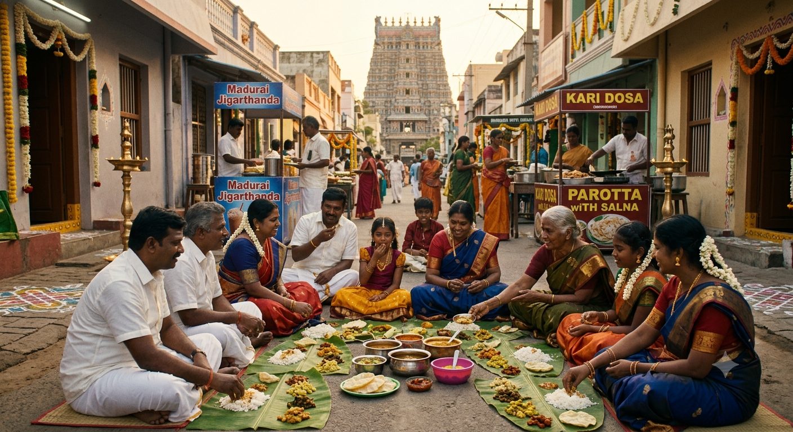
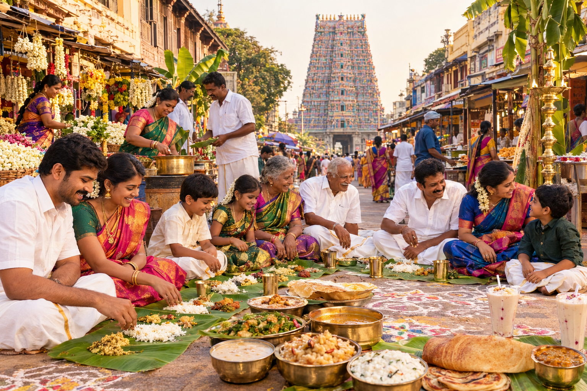

# JSON Prompts for AI Image and Video Generation

Structured JSON prompts for generating a Madurai food-culture image and a short video, plus the generated results.

> Part of my Gen AI course practice work (Week 2, Day 2).

## Tech stack

- Prompt engineering
- JSON
- Gemini image generation

## Features

- `prompts/image.json` - detailed scene prompt for an image
- `prompts/Video.json` - SCALE-style JSON prompt for a short video
- `sample_outputs/` - generated image and 5 second video

## Getting started

1. Clone the repository:
   ```bash
   git clone https://github.com/Prembazskar/json-prompts-ai-image-video.git
   cd json-prompts-ai-image-video
   ```
2. Paste the JSON into an image or video generation tool.

## Sample outputs





## License

MIT, see [LICENSE](LICENSE).
